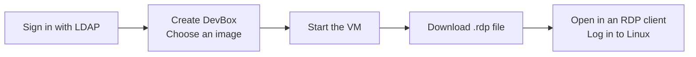

# DevBox-Gateway-kvm

[](go.mod) [](LICENSE) [](https://github.com/define42/DevBox-Gateway-kvm/actions/workflows/ci.yml) [](https://coveralls.io/github/define42/DevBox-Gateway-kvm?branch=main)

**DevBox-Gateway-kvm is a self-hosted Linux desktop gateway with a virtual
machine runtime written in Go.** Users sign in through LDAP, create persistent
desktops from shared disk images, and connect through downloaded RDP files.
Administrators manage the image catalog and desktops across accounts.

It brings the DevBox Gateway workflow into one application: the web dashboard,
authentication, cloud-init provisioning, VM lifecycle, and RDP routing. Each
desktop runs in its own `gokvm` process using Linux KVM directly.

The project is named **DevBox-Gateway-kvm** and uses the Go module path
`github.com/define42/DevBox-Gateway-kvm`. The executable remains `gokvm`; existing
command names, runtime `GOKVM_*` environment variables, helper scripts, and
`.gokvm-gateway/` state paths remain available. Gateway settings use the
[environment configuration reference](docs/configuration.md), following
DevBox-Gateway's centralized `config.go` design.

**This is experimental software. Do not use it in production.**



The browser manages desktops. The desktop itself opens in an RDP client such as
Remmina or FreeRDP and shows the VM's graphical console.

## Getting started

### Host and image requirements

The local setup below needs:

- An **x86-64 Linux host** with hardware virtualization and read/write access to
  `/dev/kvm`. Nested virtualization must be available when the host is itself a VM.
- A private, delegated **cgroup v2 subtree** configured as `VM_CGROUP_ROOT` to
  start managed VMs. The gateway does not create the delegation; see
  [VM isolation requirements](docs/gateway.md#serve-options).
- **Go 1.26 or newer**, Git, and Make.
- **OVMF firmware**: matching plain, non-SMM CODE and VARS files. The defaults are
  `/usr/share/OVMF/OVMF_CODE_4M.fd` and `/usr/share/OVMF/OVMF_VARS_4M.fd`.
- **Docker with the Compose plugin and OpenSSL** for the bundled development LDAP
  directory. An external LDAP directory can be used instead.
- **`qemu-img`** from `qemu-utils` for image conversion. Guest execution uses gokvm.
- **A C compiler, `pkg-config`, and FFmpeg development libraries** for the
  NVENC-enabled build used by `make gateway`. NVIDIA hardware is optional:
  automatic encoding falls back to software.
- Enough RAM for the configured desktops and disk space for templates and each
  VM's independent disk. A new desktop defaults to **2 vCPUs and 4 GiB RAM**.

On Debian/Ubuntu, the firmware, image tools, and native build dependencies are:

```bash
sudo apt install ovmf qemu-utils openssl build-essential pkg-config \
  libavcodec-dev libavutil-dev
```

Go, Git, Make, and Docker Compose must also be installed. For a build without a C
compiler or FFmpeg libraries, use the
[software-only gateway setup](docs/gateway.md#build-without-nvenc).

A desktop image must already contain an x86-64 UEFI-bootable Linux installation,
systemd, cloud-init, a graphical desktop, a display manager, and virtio drivers
for its disk, network, and display. Provisioning creates the user and configures
the system; it does not install a desktop into a server image.
Managed UEFI guests use a PS/2 keyboard and a virtio-input absolute tablet once
the guest driver is ready; firmware pointer input uses PS/2.
Audio playback additionally requires the guest's `snd_virtio` driver and a
working desktop audio stack; see [audio requirements](docs/runtime.md#audio).

### Prepare the sample desktop

```bash
git clone https://github.com/define42/DevBox-Gateway-kvm.git
cd DevBox-Gateway-kvm
```

The gateway can start with an empty image catalog; no desktop image is required
at startup. Prepare a sample now or upload your own compatible QCOW2 image later
through **Admin → Base Images**.

The sample uses **Rocky Linux 9 with XFCE**. From
[DevBox-Gateway v2.4.16](https://github.com/define42/DevBox-Gateway/releases/tag/v2.4.16),
download both `rocky9-xfce-v2.4.16.img.part-*` files and
`rocky9-xfce-v2.4.16.img.sha256` into this directory. Reassemble, verify, and
convert to a QCOW2 file for upload:

```bash
cat rocky9-xfce-v2.4.16.img.part-* > rocky9-xfce-v2.4.16.img
sha256sum --check rocky9-xfce-v2.4.16.img.sha256 && \
  qemu-img convert -f qcow2 -O qcow2 \
    rocky9-xfce-v2.4.16.img rocky9-xfce-v2.4.16.qcow2
```

The release's `.img` is a QCOW2 disk despite its extension. If you already have
`rocky9-xfce-v2.4.16.qcow2`, skip reconstruction and conversion. Another compatible
image can be uploaded through **Admin**.

### Start the gateway

```bash
make gateway
```

This starts the bundled LDAP directory, builds gokvm, and serves the gateway on
**https://localhost:8443**. A new state directory has an empty image catalog.
For this local setup, accept the generated self-signed certificate in your
browser and RDP client.

With `VM_CGROUP_ROOT` unset, login, image uploads, and desktop creation work, but
every VM start is refused. Before starting desktops, prepare the
[required delegation](docs/gateway.md#serve-options) and supply its path when
launching the gateway, for example:

```bash
VM_CGROUP_ROOT=/path/to/delegated-subtree make gateway
```

Sign in with one of the public development accounts:

| Account | Password | Role |
| --- | --- | --- |
| `johndoe` | `dogood` | Desktop user |
| `testuser` | `dogood` | Desktop user |
| `administrator` | `dogood` | Image and VM administrator |

These accounts are for local development. See [LDAP setup](testldap/README.md)
for directory configuration and group membership.

1. Sign in as `administrator`, open **Admin → Base Images**, and upload a
   compatible QCOW2 desktop image. The gateway validates and prepares it for use.
2. Sign in as a desktop user, select **Create DevBox**, enter a name, and choose
   an uploaded image. The progress bar reports disk preparation and configuration.
3. Select **Start**. A **running** state means the RDP console is available;
   Linux and cloud-init may still be starting.
4. Select **RDP**, then open the downloaded file in your client within two minutes.
   The file includes your LDAP login name. Enter your current gateway password
   when the RDP client prompts for credentials.
5. At the Linux graphical login, enter the username and password used to sign
   in to the gateway when you created the VM.

Download a fresh RDP file when reconnecting. The file contains no account
password, and later LDAP password changes do not update an existing guest's
password automatically.

For FreeRDP, open the downloaded file directly:

```bash
xfreerdp /path/to/desktop.rdp
```

Use an H.264-capable client for AVC420 graphics. See the [runtime guide](docs/runtime.md)
for client setup and `make freerdp` if your installed client lacks that support.
Managed desktops enable stereo sound playback over RDP by default. Enable local
sound in your client; microphone redirection is not supported.
RDP access is available only through the authenticated gateway and its downloaded
file. Standalone `boot -rdp` listeners and the direct `make rdp` helper are no
longer supported.

Shut down desktops before stopping the gateway when guest application state
matters. Gateway shutdown requests guest ACPI shutdown, then forcibly stops
workers that exceed `VM_STOP_TIMEOUT` (30 seconds by default). Saved desktops
remain on disk and can be started again. The development LDAP service stays
running until you run `make ldap-stop`.

### Run in Docker

On an x86-64 Linux host with Make, Docker Compose, and `/dev/kvm`, start both the
gateway and development LDAP directory:

Compose requires a pre-existing, private host directory for all gateway state.
For a fresh deployment on rootful Docker without UID remapping, create the
default empty directory with:

```bash
sudo install -d -m 0700 -o 10001 -g 10001 /srv/devbox-storage
```

For rootless Docker or `userns-remap`, use the host UID/GID mapped from container
UID/GID 10001 instead. To select another new, empty directory, set
`GATEWAY_STORAGE_PATH=/absolute/path` in `.env`. Compose will not create it. An
existing `gateway-state` named volume is left untouched, but is no longer
mounted or migrated automatically; the selected host path is a fresh state root.

```bash
make gateway-docker
```

This runs `./docker/configure.sh`, then `docker compose up --build -d gateway`.
Run it again after updating the checkout to rebuild the gateway and recreate
its container while preserving state in the selected host directory.

The default Compose stack starts the management plane only. Starting VMs also
requires a dedicated delegated cgroup v2 subtree, a scoped container mount, and
`VM_CGROUP_ROOT`; follow the [container delegation requirements](docs/docker.md#required-cgroup-v2-delegation-for-vm-starts).
Do not replace scoped delegation with a privileged container or a writable mount
of the host's entire cgroup hierarchy.

Open **https://localhost:8443**, accept the local self-signed certificate, and
sign in as `administrator` / `dogood`. Open **Admin → Base Images** and upload
a QCOW2 desktop image; users can then select it in **Create DevBox**. The catalog
starts empty. The host storage root contains templates under `images/`, VM disks
at `vms/<id>/disk.img`, persistent desktop state, and the gateway's TLS and ACME
state. LDAP generates its separate TLS identity in named volumes.
`docker compose down` preserves both the host bind and those LDAP volumes;
`docker compose down -v` removes the LDAP named volumes, not the host bind's
contents. The administrator remains responsible for aggregate filesystem
capacity, quotas, and free-space reserves; the per-disk virtual-size limit is
not an aggregate storage quota.

The `scratch`-based gateway image includes OVMF, `qemu-img`, and NVENC support
with automatic software fallback. The [Docker guide](docs/docker.md) covers
image uploads, storage, automatic TLS/ACME, external LDAP, and the optional
`compose.nvidia.yaml` override for NVIDIA GPUs.

## Features and behavior

### Desktop management

| Capability | Current behavior |
| --- | --- |
| Web access | HTTPS login, LDAP authentication, user dashboard, and administrator page; UI assets are bundled locally. |
| Provisioning | Independent disk, UEFI variable store, and NoCloud seed for every desktop. |
| User controls | Create, start, request shutdown, remove a stopped VM, and download an RDP connection file. |
| Creation progress | Live disk-copy progress followed by configuration and finalization; creation leaves the VM stopped. |
| Administrator controls | View all owners' VMs, start/stop/delete them, and upload or remove shared QCOW2 images. |
| Image catalog | Validated standalone QCOW2 uploads become available in Create DevBox; compressed images are normalized with `qemu-img`. |
| Desktop access | Owner-only, short-lived RDP grants; administrators do not gain access to other users' consoles. |
| Graphics | Native RDP console with bitmap or H.264 AVC420 output, software encoding, and optional NVIDIA NVENC. |
| Display and input | Virtio-gpu 2D display, keyboard and pointer input, and client-driven single-monitor resizing with guest support. |
| Audio | RDP playback enabled by default: 48 kHz stereo PCM16 with guest driver/audio-stack and client support; no microphone capture. |
| Networking | Managed VMs use DHCP, DNS, and outbound networking through `user-isolated`, which blocks host loopback destinations. |
| Persistence | VM disks, firmware settings, seeds, image catalog, and metadata survive gateway restarts. |

The default limits are **3 desktops per user**, **4 running desktops globally**,
and **20 GiB per uploaded image**, with a **30-minute upload/import request
limit**. These are configurable. The host must have sufficient resources; these
limits are not a host resource scheduler or disk quota system.

The image catalog can be empty, including after removing its last template.
Uploaded templates can be removed without deleting existing desktops because
each desktop has its own disk. Deleting a stopped desktop permanently removes its disk and firmware
state. The [gateway guide](docs/gateway.md) covers storage, image validation,
environment configuration, shutdown behavior, and backups.

### How a connection works

The public listener accepts both HTTPS and RDP on the same TCP port. After an
LDAP login, the gateway checks VM ownership and issues a single-use routing token
in the downloaded RDP file. On every RDP connection it validates the submitted
username and password against LDAP, including access-group membership, inside TLS.
The authenticated account must own the selected VM. The routing token is sent
before TLS and is visible on the wire; it cannot authorize access without a valid
password. The gateway removes the password before forwarding to the VM console.
The backend is a private Unix socket that verifies the gateway's process
identity; managed VMs expose no direct RDP TCP port.

Each VM's RDP server is part of gokvm. The guest uses its normal graphical login
and desktop session; the generated cloud-init configuration disables guest XRDP.
The console can show firmware, boot output directed to the display, and the
running desktop. Managed boot begins before you connect, so early screens may
have passed; RDP does not replay them.

Browser and RDP connections must reach the gateway from the same client IP.
Logging out revokes outstanding connection grants and closes that session's RDP
connections. A normal HTTP reverse proxy cannot carry both protocols; deployment
must preserve raw TCP access and client source addresses.

### Provisioning and image compatibility

Cloud-init configures the authenticated user's Linux account, password-protected
sudo, keyboard layout, networking, and graphical boot. Root is locked and SSH
password login is disabled. Existing guest accounts and passwords are not a live
LDAP login integration; provisioning normally runs once per VM instance.

Use a standalone QCOW2 image with the required desktop software already installed.
Images with backing files, encryption, external data files, or internal
snapshots are rejected. Successful upload validates the disk format;
it does not prove that the guest boots or its cloud-init configuration succeeds.

The gateway uses OVMF UEFI disk boot. The standalone runtime also supports direct
Linux/PVH kernel boot with an optional initrd. See
[runtime and gateway RDP reference](docs/runtime.md).

### Deployment boundaries

The local example binds to loopback. Remote access requires an explicit public
address, ACME or a trusted TLS certificate/key pair, and your LDAP directory settings.
Keep `.gokvm-gateway/` private and back it up with the service stopped. The state
contains guest password hashes and private TLS keys.

This is currently a **single-host application**. VM processes run under the
same host account; host users must be trusted. Managed guest networking blocks
host loopback access but can still reach LAN/private destinations. The RDP
implementation uses TLS and does not support NLA, clipboard/drive redirection,
or multiple monitors. Graphics are 2D; Intel VA-API and Quick Sync encoding are
not implemented. Audio supports playback only, not microphone capture.

The migrated DevBox workflow includes authentication, provisioning, RDP access,
and administrator image/VM management. The former application's libvirt, Splunk,
and Sauron integrations have not been migrated.

### Commands and documentation

| Command | Purpose |
| --- | --- |
| `gokvm serve` | Run the web gateway and manage desktop VMs. |
| `gokvm boot` | Run one guest directly for development with a serial console. |
| `gokvm seed` | Create a NoCloud seed ISO for a cloud-init-enabled guest. |
| `gokvm probe` | Inspect host KVM capabilities and CPUID information. |
| `gokvm auth-user` | Create a local authentication file for explicit loopback development setups. |

Run `./gokvm serve -help`, `./gokvm boot -help`, or `./gokvm seed -help` for the
current flags. `serve` reads configuration from environment variables; explicit
flags override them. LDAP is the authentication path used by `make gateway`.

- [Environment configuration](docs/configuration.md): all gateway variables,
  defaults, flag overrides, and Compose migration.
- [Gateway operations](docs/gateway.md): configuration, external LDAP/TLS, image
  management, connection tokens, state, and cloud-init.
- [VM and remote-display reference](docs/runtime.md): developer boot modes,
  firmware, gateway RDP clients, encoding, and troubleshooting.
- [Development guide](docs/development.md): package layout, builds, tests, tracing,
  and low-level virtualization references.
- [Bundled LDAP directory](testldap/README.md): development accounts and directory setup.
- [H.264 library](pkg/h264/README.md): the separately importable codec API.
- [Documentation index for tools](llms.txt): entry points for repository and
  operational documentation.

## Contributing

Read [CONTRIBUTING.md](CONTRIBUTING.md) for the contribution workflow and focused
checks.

Build the application from the repository root:

```bash
CGO_ENABLED=0 go build -o gokvm .
```

This includes software H.264 encoding. Each push to `main` publishes its tested
head commit to [GitHub Releases](https://github.com/define42/DevBox-Gateway-kvm/releases)
after CI passes. Versions use the commit's UTC date and time plus its short SHA,
for example `v2026.10.11-195952-g012345abcdef`. A rerun reuses the same version.
Pull requests and scheduled checks do not publish releases.

Releases include a Linux amd64 binary archive and SHA-256 checksums. The gateway
and LDAP containers are published to GHCR with the same version
and full commit SHA; see [published container images](docs/docker.md#published-container-images).
For development checks and VM test fixtures, follow the
[development guide](docs/development.md). Include a reproduction or focused test
for behavior changes and update the relevant user guide when changing a workflow.

Application packages live under `internal/`. The public Go library paths are
`github.com/define42/DevBox-Gateway-kvm/kvm`,
`github.com/define42/DevBox-Gateway-kvm/pkg/h264`, and
`github.com/define42/DevBox-Gateway-kvm/pkg/h264/api`.

## Contributors

DevBox-Gateway-kvm builds on
[Nobuhiro MIKI's original project](https://github.com/bobuhiro11/gokvm) and carries forward the desktop workflow and UI assets from
[DevBox-Gateway](https://github.com/define42/DevBox-Gateway). Thanks to everyone
contributing code, tests, bug reports, and documentation; see the
[contributors](https://github.com/define42/DevBox-Gateway-kvm/graphs/contributors).

## License

DevBox-Gateway-kvm is licensed under the [MIT License](LICENSE). The bundled
OpenH264 port is covered by the [BSD 2-Clause license](LICENSE-OpenH264). The repository also
retains the [go.264 license notice](LICENSE-go.264), and the copied gateway UI and
LDAP assets retain their upstream license notices.
