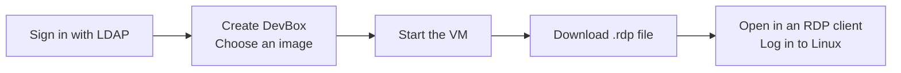

# devbox-kvm

[](go.mod) [](LICENSE) [](https://github.com/define42/DevBox-Gateway-kvm/actions/workflows/ci.yml) [](https://coveralls.io/github/define42/DevBox-Gateway-kvm?branch=main)

**devbox-kvm is a self-hosted Linux desktop gateway with a virtual
machine runtime written in Go.** Users sign in through LDAP, create persistent
desktops from shared disk images, and connect through downloaded RDP files.
Administrators manage the image catalog and desktops across accounts.

It brings the DevBox Gateway workflow into one application: the web dashboard,
authentication, cloud-init provisioning, VM lifecycle, and RDP routing. Each
desktop runs in its own `devbox-kvm` process using Linux KVM directly.

The repository is named **DevBox-Gateway-kvm** and uses the Go module path
`github.com/define42/DevBox-Gateway-kvm`. The executable is `devbox-kvm`, runtime
and test environment variables use the `DEVBOX_KVM_*` prefix. The packaged service
stores state in `/var/lib/devbox-kvm`; a source build defaults to
`.devbox-kvm-gateway/`. Gateway settings use the
[environment configuration reference](docs/configuration.md), following
DevBox-Gateway's centralized `config.go` design.

**Ready for production use at test scale.**



The browser manages desktops. The desktop itself opens in an RDP client such as
Remmina or FreeRDP and shows the VM's graphical console.

## Getting started

### Host and image requirements

Running managed desktops needs:

- An **x86-64 Linux host** with hardware virtualization and read/write access to
  `/dev/kvm`. Nested virtualization must be available when the host is itself a VM.
- **Linux 6.12+ with Landlock ABI 6 enabled and seccomp** for managed worker confinement.
- **cgroup v2** with memory and pids controllers. The packaged service creates
  private delegation automatically using **systemd 254 or newer**. Source and
  container setups must supply `VM_CGROUP_ROOT`; see
  [VM isolation requirements](docs/gateway.md#serve-options).
- An LDAP directory for user authentication and administrator access.
- Enough RAM for the configured desktops and disk space for templates and each
  VM's independent disk. A new desktop defaults to **2 vCPUs and 4 GiB RAM**.

The application builds with `CGO_ENABLED=0` and needs no C compiler or native
libraries. H.264 encoding uses the bundled pure Go codec; guest graphics use a 2D framebuffer. Matching
plain, non-SMM OVMF CODE and VARS firmware is embedded in the executable. The
gateway extracts it under `DATA_ROOT_DIR/firmware` at startup and keeps a separate
writable variables file for each VM; no host OVMF installation is required.

A desktop image must already contain an x86-64 UEFI-bootable Linux installation,
systemd, cloud-init, a graphical desktop, a display manager, and virtio drivers
for its disk, network, and display. Provisioning creates the user and configures
the system; it does not install a desktop into a server image.
Managed UEFI guests use a PS/2 keyboard and a virtio-input absolute tablet once
the guest driver is ready; firmware pointer input uses PS/2.
Audio playback additionally requires the guest's `snd_virtio` driver and a
working desktop audio stack; see [audio requirements](docs/runtime.md#audio).

### Install a DEB or RPM package

Download the Linux amd64 `.deb` or `.rpm` and `checksums.txt` from
[GitHub Releases](https://github.com/define42/DevBox-Gateway-kvm/releases).
Releases contain native packages and SHA-256 checksums only; container images
and standalone binary archives are no longer published.

Follow the [package installation guide](docs/packages.md) to verify and install
one package, configure `/etc/devbox-kvm/devbox-kvm.env` for your LDAP directory,
and start the service:

```bash
sudoedit /etc/devbox-kvm/devbox-kvm.env
sudo systemctl enable --now devbox-kvm
```

Installation leaves the service stopped until it is configured. The default
listener is **https://localhost:8443**. The package supplies the service account,
private state directory, KVM group access, and cgroup delegation. No Go toolchain,
Docker, host OVMF package, or bundled LDAP directory is needed.

Sign in with an account in your configured `ADMIN_GROUP`, upload a compatible
QCOW2 image through **Admin → Base Images**, and follow the
[desktop workflow](docs/gateway.md#create-and-connect-to-a-desktop).
For remote access, configure the listener, public address, and trusted TLS as
covered in the package guide.

### Local development from source

Source builds require **Go 1.26 or newer**, Git, and Make. The bundled development
LDAP setup also needs **Docker with the Compose plugin and OpenSSL**. On
Debian/Ubuntu, install the local TLS tools with
`sudo apt install openssl ca-certificates`.

### Prepare the sample desktop

```bash
git clone https://github.com/define42/DevBox-Gateway-kvm.git
cd DevBox-Gateway-kvm
```

The gateway can start with an empty image catalog; no desktop image is required
at startup. Prepare a sample now or upload your own compatible QCOW2 image later
through **Admin → Base Images**.

The sample uses **Rocky Linux 9 with XFCE**. From
[DevBox-Gateway v2.4.16](https://github.com/define42/DevBox-Gateway/releases/tag/v2.4.16),
download both `rocky9-xfce-v2.4.16.img.part-*` files and
`rocky9-xfce-v2.4.16.img.sha256` into this directory. Reassemble and verify the
disk before uploading it:

```bash
cat rocky9-xfce-v2.4.16.img.part-* > rocky9-xfce-v2.4.16.img
sha256sum --check rocky9-xfce-v2.4.16.img.sha256
```

The release's `.img` is a QCOW2 disk despite its extension and can be uploaded
directly. The gateway validates and normalizes compressed QCOW2 images in Go;
no external conversion tool is required. If you already have
`rocky9-xfce-v2.4.16.qcow2`, skip reconstruction. Another compatible image can
be uploaded through **Admin**.

### Start the gateway

Prepare the [required memory and pids delegation](docs/gateway.md#serve-options),
then supply its path when launching the gateway as a non-root user:

```bash
VM_CGROUP_ROOT=/path/to/delegated-subtree make gateway
```

This starts the bundled LDAP directory, builds devbox-kvm, and serves the gateway
on **https://localhost:8443**. Startup checks require kernel confinement, KVM
access, and valid cgroup delegation; an unset `VM_CGROUP_ROOT` prevents startup.
See [startup checks](docs/packages.md#startup-checks) for failures and host
requirements. A new state directory has an empty image catalog. For this local
setup, accept the generated self-signed certificate in your browser and RDP client.

Sign in with one of the public development accounts:

| Account | Password | Role |
| --- | --- | --- |
| `johndoe` | `dogood` | Desktop user |
| `testuser` | `dogood` | Desktop user |
| `administrator` | `dogood` | Image and VM administrator |

These accounts are for local development. See [LDAP setup](testldap/README.md)
for directory configuration and group membership.

1. Sign in as `administrator`, open **Admin → Base Images**, and upload a
   compatible QCOW2 desktop image. The gateway validates and prepares it for use.
2. Sign in as a desktop user, select **Create DevBox**, enter a name, and choose
   an uploaded image. The progress bar reports disk preparation and configuration.
3. Select **Start**. A **running** state means the RDP console is available;
   Linux and cloud-init may still be starting.
4. Select **RDP**, then open the downloaded file in your client within two minutes.
   The file includes your LDAP login name. Enter your current gateway password
   when the RDP client prompts for credentials. The profile leaves client-side
   CredSSP support enabled so Microsoft Remote Desktop can collect credentials,
   but the gateway selects TLS and does not implement server-side NLA.
5. At the Linux graphical login, enter the username and password used to sign
   in to the gateway when you created the VM.

Download a fresh RDP file when reconnecting. The file contains no account
password, and later LDAP password changes do not update an existing guest's
password automatically.

For FreeRDP, open the downloaded file directly:

```bash
xfreerdp /path/to/desktop.rdp
```

Use an H.264-capable client for AVC420 graphics. See the [runtime guide](docs/runtime.md)
for client setup and `make freerdp` if your installed client lacks that support.
Operators can temporarily force newly started workers to bitmap output with
`GATEWAY_RDP_BITMAP_ONLY=true` for a controlled compatibility test; see the
[configuration and rollback procedure](docs/configuration.md#storage-and-desktops).
Managed desktops enable stereo sound playback over RDP by default. Enable local
sound in your client; microphone redirection is not supported.
RDP access is available only through the authenticated gateway and its downloaded
file. Standalone `boot -rdp` listeners and the direct `make rdp` helper are no
longer supported.

Shut down desktops before stopping the gateway when guest application state
matters. Gateway shutdown requests guest ACPI shutdown, then forcibly stops
workers that exceed `VM_STOP_TIMEOUT` (30 seconds by default). Saved desktops
remain on disk and can be started again. The development LDAP service stays
running until you run `make ldap-stop`.

### RDP diagnostics

After reproducing an RDP connection failure, an administrator can select
**Download diagnostics** on the Admin page. The report contains UTC timestamps,
connection stages, and sanitized error categories for all retained recent RDP
events, including failures that occur before a routing grant identifies a user
or VM. The rolling log keeps the last 512 events in process memory, resets when
the gateway restarts, and is most useful when downloaded immediately after the
failure.

Client Info validation failures can also include a fixed, optional `reason` that
distinguishes empty credentials, an unsupported smart-card PIN, and invalid
security headers or packet framing. These reasons never contain submitted
values, raw flags, or packet lengths.

A terminal `session_proxy` event can include `proxyOperation` and `proxyError`.
The operation is the first failing I/O observed by the relay: `front` is the RDP
client and `backend` is the VM. It does not prove which endpoint initiated the
disconnect because cancellation or simultaneous failures can select either
operation. The error is a fixed category; neither field contains raw error text.

The report identifies the running `devbox-kvm` version and includes commit and
build-date metadata when the binary contains it; unversioned development builds
report `devel`. When worker diagnostics are available, the administrator report
also includes cached `rdpWorkers.vms[].sessions` snapshots. The same history is
exposed to an owner as `VMPerformance.rdpSessions`. Each worker keeps only its
four most recent terminal RDP sessions, with a worker-local sequence, UTC
timestamp, last stage, outcome, sanitized error, and duration in milliseconds.
An optional fixed `reason` identifies a dynamic-channel capability rejection
check (`dvc_caps_state`, `dvc_caps_length`, `dvc_caps_header`, or
`dvc_caps_version`), without packet contents or peer-controlled text. A
`frame_write` stage can indicate a client closing during transmission; it does
not by itself prove an encoding failure.
These records remain only until bounded eviction or worker restart; their
sequence values are not gateway attempt IDs. Wait at least five seconds after
reproducing a failure so the next worker heartbeat can update the cache.

The **Download diagnostics** action on **My DevBoxes** remains owner-scoped
through `/perf` and does not expose other users' attempts. An `authenticated` RDP
event means gateway credential validation succeeded; it does not prove that the
guest desktop was displayed. After upgrading this instrumentation, redeploy the
gateway and restart each affected VM worker. The export does not collect raw
worker standard error. A reported Microsoft client error `0x1304` is still under
investigation and is not fixed merely by the credential-profile change.

For a self-contained Microsoft-client rendering and keyboard check, see
[Windows-only RDP compatibility CI](docs/windows-rdp-ci.md). The manual workflow
builds our Go RDP test server from the selected commit and runs it alongside the
Microsoft client on one Windows runner, comparing H.264 and bitmap without KVM,
external gateways, or credentials to configure. It tests the protocol, not VM
boot or gateway authentication. The separate
[gateway compatibility workflow](docs/windows-rdp-gateway-ci.md) covers the full
path against predeployed, isolated Linux/KVM test gateways.

### Build and run locally in Docker

Docker and Compose remain available for local development builds; releases
provide [DEB and RPM packages](docs/packages.md).

On an x86-64 Linux host with Make, Docker Compose, and `/dev/kvm`, start both the
gateway and development LDAP directory:

Compose requires a pre-existing, private host directory for all gateway state.
For a fresh deployment on rootful Docker without UID remapping, create the
default empty directory with:

```bash
sudo install -d -m 0700 -o 10001 -g 10001 /srv/devbox-storage
```

For rootless Docker or `userns-remap`, use the host UID/GID mapped from container
UID/GID 10001 instead. To select another new, empty directory, set
`GATEWAY_STORAGE_PATH=/absolute/path` in `.env`. Compose will not create it. An
existing `gateway-state` named volume is left untouched, but is no longer
mounted or migrated automatically; the selected host path is a fresh state root.

Gateway startup requires a dedicated delegated cgroup v2 subtree, a scoped
container mount, and `VM_CGROUP_ROOT`; follow the
[container delegation requirements](docs/docker.md#required-cgroup-v2-delegation-for-vm-starts).
The base Compose file alone does not provide these and cannot start the gateway.
Do not replace scoped delegation with a privileged container or a writable mount
of the host's entire cgroup hierarchy.

For the supported rootful Docker/systemd setup described in that guide, run:

```bash
sudo ./docker/setup-cgroup.sh
make docker
```

`make docker` configures KVM access, then builds and starts the gateway and LDAP
with software rendering and encoding. It selects the base and cgroup Compose
files. Run it again after updating the checkout to rebuild while preserving
state in the selected host directory. Host Go is not required.
Every image contains the static Go application and bundled Go H.264 encoder;
`make docker-purego` is an alias for `make docker`.

Open **https://localhost:8443**, accept the local self-signed certificate, and
sign in as `administrator` / `dogood`. Open **Admin → Base Images** and upload
a QCOW2 desktop image; users can then select it in **Create DevBox**. The catalog
starts empty. The host storage root contains templates under `images/`, VM disks
at `vms/<id>/disk.img`, persistent desktop state, and the gateway's TLS and ACME
state. LDAP generates its separate TLS identity in named volumes.
`docker compose down` preserves both the host bind and those LDAP volumes;
`docker compose down -v` removes the LDAP named volumes, not the host bind's
contents. The administrator remains responsible for aggregate filesystem
capacity, quotas, and free-space reserves; the per-disk virtual-size limit is
not an aggregate storage quota.

The `scratch`-based gateway image includes the static Go application with
embedded OVMF firmware and CA certificates. The [Docker guide](docs/docker.md)
covers image uploads, storage, automatic TLS/ACME, and external LDAP.

## Features and behavior

### Desktop management

| Capability | Current behavior |
| --- | --- |
| Web access | HTTPS login, LDAP authentication, user dashboard, and administrator page; UI assets are bundled locally. |
| Provisioning | Independent disk, UEFI variable store, and NoCloud seed for every desktop. |
| User controls | Create, start, request shutdown, remove a stopped VM, and download an RDP connection file. |
| Creation progress | Live disk-copy progress followed by configuration and finalization; creation leaves the VM stopped. |
| Administrator controls | View all owners' VMs, start/stop/delete them, and upload or remove shared QCOW2 images. |
| Image catalog | Validated standalone QCOW2 uploads become available in Create DevBox; DEFLATE- and Zstd-compressed images are normalized in Go. |
| Desktop access | Owner-only, short-lived RDP grants; administrators do not gain access to other users' consoles. |
| Graphics | Native RDP console with bitmap or H.264 AVC420 output using the bundled pure Go encoder. |
| Display and input | 2D virtio-gpu framebuffer, keyboard and pointer input, and client-driven single-monitor resizing with guest support. |
| Audio | RDP playback enabled by default: 48 kHz stereo PCM16 with guest driver/audio-stack and client support; no microphone capture. |
| Networking | Managed VMs use bounded DHCP/DNS and IPv4 outbound networking; host/LAN access requires explicit allowed CIDRs. |
| Persistence | VM disks, firmware settings, seeds, image catalog, and metadata survive gateway restarts. |

The default limits are **3 desktops per user**, **4 running desktops globally**,
and **20 GiB per uploaded image**, with a **30-minute upload/import request
limit**. These are configurable. The host must have sufficient resources; these
limits are not a host resource scheduler or disk quota system.

The image catalog can be empty, including after removing its last template.
Uploaded templates can be removed without deleting existing desktops because
each desktop has its own disk. Deleting a stopped desktop permanently removes its disk and firmware
state. The [gateway guide](docs/gateway.md) covers storage, image validation,
environment configuration, shutdown behavior, and backups.

### How a connection works

The public listener accepts both HTTPS and RDP on the same TCP port. After an
LDAP login, the gateway checks VM ownership and issues a single-use routing token
in the downloaded RDP file. On every RDP connection it validates the submitted
username and password against LDAP, including access-group membership, inside TLS.
The authenticated account must own the selected VM. The routing token is sent
before TLS and is visible on the wire; it cannot authorize access without a valid
password. The gateway removes the password before forwarding to the VM console.
The backend is a private Unix socket that verifies the gateway's process
identity; managed VMs expose no direct RDP TCP port.

Each VM's RDP server is part of devbox-kvm. The guest uses its normal graphical login
and desktop session; the generated cloud-init configuration disables guest XRDP.
The console can show firmware, boot output directed to the display, and the
running desktop. Managed boot begins before you connect, so early screens may
have passed; RDP does not replay them.

Browser and RDP connections must reach the gateway from the same client IP.
Logging out revokes outstanding connection grants and closes that session's RDP
connections. A normal HTTP reverse proxy cannot carry both protocols; deployment
must preserve raw TCP access and client source addresses.

### Provisioning and image compatibility

Cloud-init configures the authenticated user's Linux account, password-protected
sudo, keyboard layout, networking, and graphical boot. Root is locked and SSH
password login is disabled. Existing guest accounts and passwords are not a live
LDAP login integration; provisioning normally runs once per VM instance.

Use a standalone QCOW2 image with the required desktop software already installed.
Images with backing files, encryption, external data files, or internal
snapshots are rejected. Successful upload validates the disk format;
it does not prove that the guest boots or its cloud-init configuration succeeds.

The gateway uses OVMF UEFI disk boot. The standalone runtime also supports direct
Linux/PVH kernel boot with an optional initrd. See
[runtime and gateway RDP reference](docs/runtime.md).

### Deployment boundaries

The default listener binds to loopback. Remote access requires an explicit public
address, ACME or a trusted TLS certificate/key pair, and your LDAP directory settings.
Keep the state directory private (`/var/lib/devbox-kvm` for the packaged service,
`.devbox-kvm-gateway/` for source builds) and back it up with the service stopped. The state
contains guest password hashes and private TLS keys.

This is currently a **single-host application**. VM processes run under the
same host account, with a separate Landlock filesystem/IPC domain and seccomp
filter for each managed worker. Host users must still be trusted. Managed guest
networking restricts private ranges and visible host interface subnets; see the
[worker sandbox](docs/worker-sandbox.md) and [network policy](docs/runtime.md#networking). The
downloaded RDP profile lets the client advertise CredSSP, but the gateway selects
TLS and does not implement server-side NLA. It also does not support
clipboard/drive redirection or multiple monitors. Graphics use a 2D virtio-gpu
framebuffer; host GPU acceleration and guest 3D command processing are not
supported. Audio supports playback only, not microphone capture.

The migrated DevBox workflow includes authentication, provisioning, RDP access,
and administrator image/VM management. The former application's libvirt, Splunk,
and Sauron integrations have not been migrated.

### Commands and documentation

| Command | Purpose |
| --- | --- |
| `devbox-kvm serve` | Run the web gateway and manage desktop VMs. |
| `devbox-kvm boot` | Run one guest directly for development with a serial console. |
| `devbox-kvm seed` | Create a NoCloud seed ISO for a cloud-init-enabled guest. |
| `devbox-kvm probe` | Inspect host KVM capabilities and CPUID information. |
| `devbox-kvm auth-user` | Create a local authentication file for explicit loopback development setups. |

Run `./devbox-kvm serve -help`, `./devbox-kvm boot -help`, or `./devbox-kvm seed -help` for the
current flags. `serve` reads configuration from environment variables; explicit
flags override them. LDAP is the authentication path used by `make gateway`.

- [Native packages](docs/packages.md): DEB/RPM installation, systemd service,
  upgrades, and release behavior.
- [Environment configuration](docs/configuration.md): all gateway variables,
  defaults, flag overrides, and Compose migration.
- [Gateway operations](docs/gateway.md): configuration, external LDAP/TLS, image
  management, connection tokens, state, and cloud-init.
- [VM and remote-display reference](docs/runtime.md): developer boot modes,
  firmware, gateway RDP clients, encoding, and troubleshooting.
- [Development guide](docs/development.md): package layout, builds, tests, tracing,
  and low-level virtualization references.
- [Bundled LDAP directory](testldap/README.md): development accounts and directory setup.
- [H.264 library](pkg/h264/README.md): the separately importable codec API.
- [Documentation index for tools](llms.txt): entry points for repository and
  operational documentation.

Dated benchmark reports and their evidence retain the application names and
paths recorded at the measured revision; use the current guides for setup.

## Contributing

Read [CONTRIBUTING.md](CONTRIBUTING.md) for the contribution workflow and focused
checks.

Build the application from the repository root:

```bash
make devbox-kvm
# Or: CGO_ENABLED=0 go build -o devbox-kvm .
```

Application and release builds use `CGO_ENABLED=0`, including the bundled Go
H.264 codec. Race tests enable cgo only for Go's race instrumentation; see the
[development guide](docs/development.md#build-and-contribute).
Each push to `main` publishes its tested
head commit to [GitHub Releases](https://github.com/define42/DevBox-Gateway-kvm/releases)
after CI passes. Versions use the commit's UTC date and time plus its short SHA,
for example `v2026.10.11-195952-g012345abcdef`. A rerun reuses the same version.
Pull requests and scheduled checks do not publish releases.

Releases include Linux amd64 **DEB and RPM packages** and SHA-256 checksums.
Retries preserve published releases; only a release for the current `main` head
becomes `latest`. See [native packages](docs/packages.md) for installation and
release behavior. Containers are built locally only and are not released.
For development checks and VM test fixtures, follow the
[development guide](docs/development.md). Include a reproduction or focused test
for behavior changes and update the relevant user guide when changing a workflow.

Application packages live under `internal/`. The public Go library paths are
`github.com/define42/DevBox-Gateway-kvm/kvm`,
`github.com/define42/DevBox-Gateway-kvm/pkg/h264`, and
`github.com/define42/DevBox-Gateway-kvm/pkg/h264/api`.

## Contributors

DevBox-Gateway-kvm builds on
[Nobuhiro MIKI's original project](https://github.com/bobuhiro11/gokvm) and carries forward the desktop workflow and UI assets from
[DevBox-Gateway](https://github.com/define42/DevBox-Gateway). Thanks to everyone
contributing code, tests, bug reports, and documentation; see the
[contributors](https://github.com/define42/DevBox-Gateway-kvm/graphs/contributors).

## License

DevBox-Gateway-kvm is licensed under the [MIT License](LICENSE). The bundled
OpenH264 port is covered by the [BSD 2-Clause license](LICENSE-OpenH264). The repository also
retains the [go.264 license notice](LICENSE-go.264). The QCOW2 import reader
retains its [upstream license notice](internal/qcow2import/LICENSE), and the
copied gateway UI and LDAP assets retain their upstream license notices.
